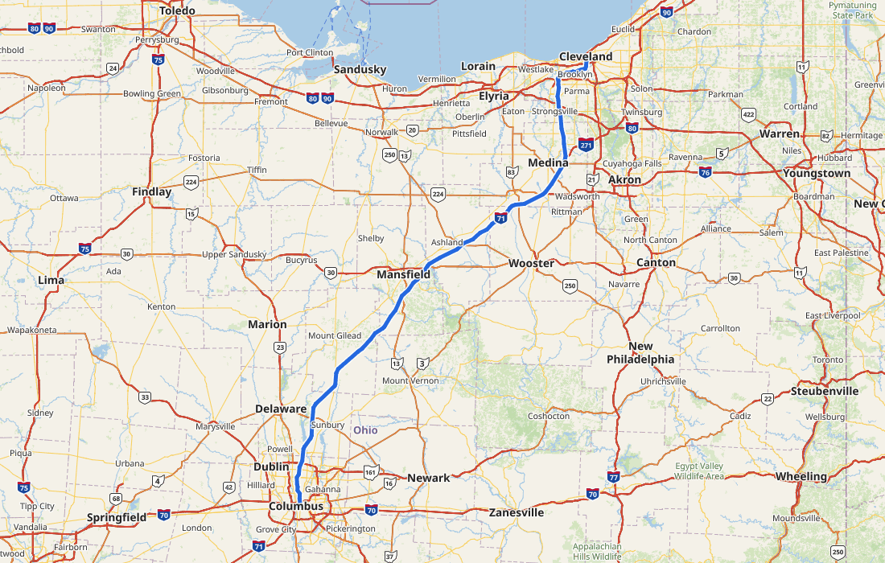

# Offline Road Maps

Road maps, search and driving directions for the whole of North America that work with no internet connection, from a USB stick or a folder. Nothing in the program ever connects to a network.

- **Map:** the United States and Canada, from the whole continent down to individual streets, in a default, a night and a high-contrast style.
- **Search:** places, streets and addresses (151 million of them), as you type.
- **Routes:** car routes with alternatives, turn-by-turn directions, saved trips and pushpins.
- **Print:** a route's map and directions to a printer or a PDF.
- **Portable:** the program, the maps (one 9 GB file set for all of North America) and your settings, trips and pins live in one folder. Windows and Linux; copy the folder to take it with you.

| Route | Night style | Print |
|---|---|---|
|  |  |  |

## Get it

A release is a folder: `OfflineRoadMaps.exe` for Windows, `OfflineRoadMaps.sh` for Linux, `maps/` and a `README.txt` that explains the rest. Put it on an exFAT stick or any disk and start the program. The maps are far too large to be in a download, so build your own with [docs/BUILDING.md](docs/BUILDING.md) (Delaware takes 12 seconds; all of North America takes about 40 minutes and 47 GiB of RAM).

## Build it yourself

[docs/BUILDING.md](docs/BUILDING.md) walks through everything: the tools, getting the data, building a region (a state, a province, North America or a polygon you draw), building the program, and making the release folder for Windows and Linux.

## For developers

[docs/DEVELOPING.md](docs/DEVELOPING.md): running from source, the `--render` and `--bench` modes, the checks. The design, the file format ([docs/format.md](docs/format.md)), the plans and the measurements behind them are in [docs/roadmap.md](docs/roadmap.md) and [docs/dev/](docs/dev/).

The `omp` in crate names, environment variables and the `.omp` map files stands for Offline MaPs.

## License

MIT or Apache-2.0, at your option ([LICENSE-MIT](LICENSE-MIT), [LICENSE-APACHE](LICENSE-APACHE)). The notices of everything the program contains (Rust libraries, the Noto Sans font under the SIL Open Font License, the Maki icons under CC0) are generated into `licenses/THIRD-PARTY.txt` in each release. Map data © [OpenStreetMap contributors](https://www.openstreetmap.org/copyright) (ODbL); the address sources are listed in the program's *About this map*.
