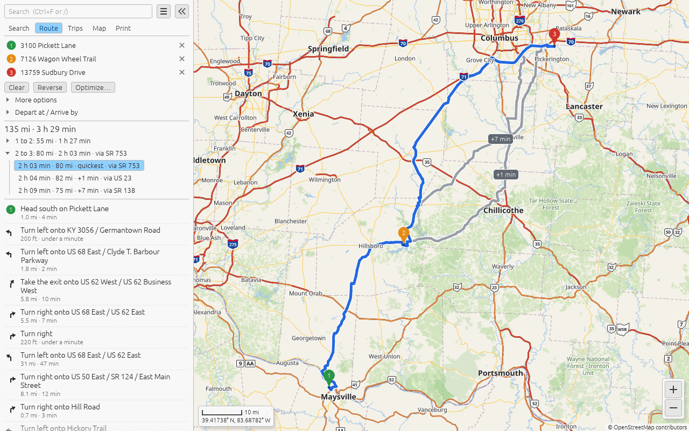
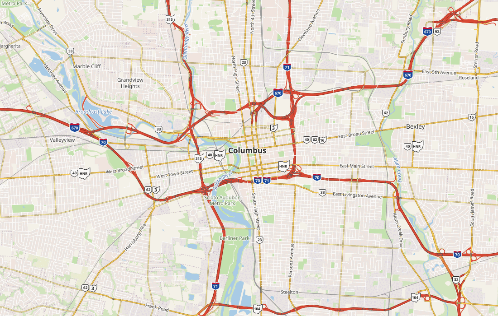
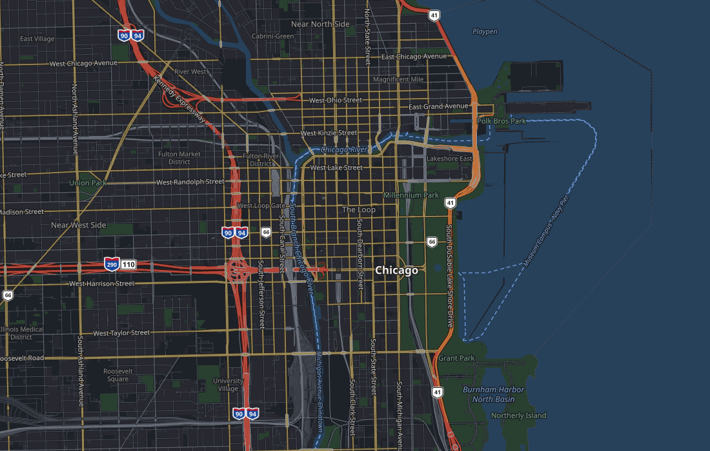
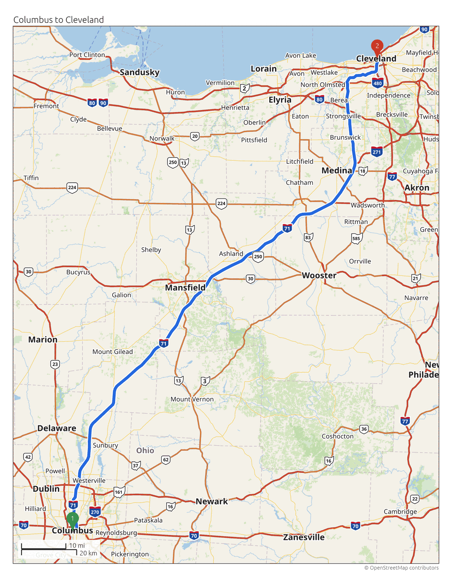

# Offline Road Maps

Road maps, search and driving directions for the whole of North America that work with no internet connection, from a USB stick or a folder. Nothing in the program ever connects to a network.

- **Map:** detailed street maps built from [OpenStreetMap](https://www.openstreetmap.org/) data and stored in compact map packs, with several built-in styles.
- **Search:** places, streets and addresses (151 million in the North America pack), as you type.
- **Routes:** car routes with alternatives, turn-by-turn directions, saved trips and pushpins.
- **Print:** a route's map and directions to a printer or a PDF.
- **Portable:** the program, the maps, and your settings, trips and pins live in one folder that works on both Windows and Linux. All of North America, with the program, is under 10 GB.

| Street map | Night style | Print |
|---|---|---|
|  |  |  |

## Get it

There are two ways to get Offline Road Maps. Either one ends with the same thing: one folder (or USB stick) that holds the program and the maps, and runs on Windows and Linux with nothing to install.

**Have one made for you.** The maps for all of North America are about 9 GB, far too large for the git repository, and I don't run any infrastructure to host them. If you'd rather not build them, email me at [nicholasyoder@proton.me](mailto:nicholasyoder@proton.me) and I can set up a USB stick with the program and the maps and mail it to you, for a fee that covers the USB stick, postage, and my time.

**Build it yourself.** This is free. It needs a reasonably modern computer and an internet connection for the one-time download of the map data, and you run a few commands in a terminal. [docs/BUILDING.md](docs/BUILDING.md) goes through it step by step:

- a single state or province takes a few minutes to about 15, download included (Delaware: about 5 minutes, of which the build is 12 seconds);
- all of North America takes about 3 hours, most of it downloading 35 GB, and the build (about 45 minutes) needs a computer with at least 48 GB of RAM;
- these times assume at least a 50 Mbit/s connection; a slower one means more time spent on downloads;
- you can also cut your own region, such as one metro area, from a polygon you draw.

BUILDING.md also covers building the program itself and putting everything into a release folder for Windows and Linux.

## For developers

See [docs/DEVELOPING.md](docs/DEVELOPING.md) for running from source and the `--render` and `--bench` modes. The design, file format, plans and the measurements behind them are in [docs/roadmap.md](docs/roadmap.md), [docs/format.md](docs/format.md), and [docs/dev/](docs/dev/).

The `omp` in crate names, environment variables and the `.omp` map files stands for Offline MaPs.

## License

MIT or Apache-2.0, at your option ([LICENSE-MIT](LICENSE-MIT), [LICENSE-APACHE](LICENSE-APACHE)). The notices of everything the program contains (Rust libraries, the Noto Sans font under the SIL Open Font License, the Maki icons under CC0) are generated into `licenses/THIRD-PARTY.txt` in each release. Map data © [OpenStreetMap contributors](https://www.openstreetmap.org/copyright) (ODbL); the address sources are listed in the program's *About this map*.
